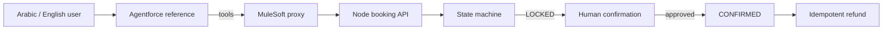

# Agentic Railway Booking Platform

> One synthetic, end-to-end enterprise reference connecting an Agentforce-style agent, a Node booking domain, an OpenAPI contract, and a MuleSoft proxy.



## Quickstart

```bash
npm install
npm run check
npm run demo
```

No credentials or external systems are used. Stations, travelers, currency, endpoints, and payment references are fictional.

## What I built

- A booking state machine with lock, approval, confirmation, payment-failure, and refund paths.
- Idempotency enforcement for retry-safe booking.
- A generic Agentforce agent contract with mandatory tool use.
- An OpenAPI 3.1 contract and environment-driven MuleSoft proxy.
- Twenty scenarios across 60 deterministic trials.

## Evidence

Tests cover missing passenger data, duplicate requests, explicit confirmation, payment failure, and refund idempotency. The evaluator publishes functional and approval-safety results in `evals/results.json`.

## What is mocked

The adapter returns one synthetic trip, no payment is performed, and the Mule flow is validated structurally rather than deployed.

## Known limitations

This repository demonstrates integration boundaries and failure behavior; it is not affiliated with or connected to a real railway operator.

See [SECURITY.md](SECURITY.md) and [PROVENANCE.md](PROVENANCE.md).
